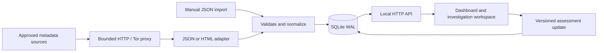

# Architecture and engineering decisions

Version 0.3 adds provider adapters, a foreground monitor worker, persisted source scheduling state and schema version 3. See [live operations](LIVE.fr.md). The original schema-2 migration description below remains historical; migration 3 adds source state and a nullable provider observation timestamp without inventing history.



## Persistence boundaries

A claim preserves its original listing metadata. Source observations track source label + URL, first/last observation, and a sightings count. Repeated rows count as repeated sightings, not distinct collection runs. Metadata corrections and separate incidents for the same actor/organization remain future work.

An investigation is separate from source data. `new`, `investigating`, `reviewed`, and `dismissed` are analyst workflow states, not breach confirmation labels. Priority is selected by an analyst; there is no opaque risk score.

Each assessment save checks the version under a write transaction, updates the assessment, and appends a before/after audit event atomically. A stale version yields HTTP 409. A failure rolls back the full operation. History returned by the API is capped at the latest 50 events; source observations are not paginated.

## Database compatibility

Schema version 2 adds `investigations`, `audit_events`, and `observations` using additive DDL. Existing claims retain IDs and timestamps. Historical observations cannot be reconstructed and are not fabricated: legacy records have no observation entries until they are ingested again. A test exercises an original-schema database through migration.

## Selected tradeoffs

| Decision | Benefit | Cost / next step |
| --- | --- | --- |
| SQLite and standard-library HTTP API | Easy local setup and transparent code | Not a production multi-user server |
| Casefolded actor/name identity | Deterministic deduplication | Name variants and repeat incidents need entity/incident modeling |
| Separate assessment state | Source claims remain distinguishable from analyst judgment | Requires dedicated query joins |
| Optimistic version checks | Prevent stale browser overwrites | User must reopen on conflict; no automatic merge |
| Additive provenance summary | Track multiple source sightings with bounded duplication | No full content snapshot or per-poll evidence archive |
| Synthetic demo | Reproducible, shareable portfolio | Cannot support real-world performance claims |

## API additions

`GET /api/investigation?id=<claim-id>` returns status, priority, notes, version, observations and up to 50 audit events.

`POST /api/investigation` requires JSON:

```json
{"id":"<claim-id>","version":0,"status":"investigating","priority":"high","notes":"Verification pending"}
```

Responses: 200 on success, 400 on invalid input, 404 for an unknown claim, 409 on version conflict. Notes are limited to 5,000 characters. Dashboard and CSV endpoints accept optional `status=new|investigating|reviewed|dismissed`; CSV adds status and priority but excludes private analyst notes.

## Verification scope

The automated suite checks persistence, additive migration, multiple-source provenance, invalid input, source failure isolation, stale edits, transactional history, API filters, exports, and Host/Origin restrictions. It uses temporary databases and local HTTP servers. CI configuration extends this to a Python version matrix, but a local test run does not prove that GitHub CI has run.

Manual UI acceptance: load demo; search; filter status; open a claim; save notes; reload; inspect history; reproduce a two-tab conflict; export CSV; check empty state; check keyboard navigation and a narrow viewport. A browser test is a separate gate from API tests.

## References

- [GitHub: building and testing Python](https://docs.github.com/en/actions/tutorials/build-and-test-code/python)
- [Official setup-python action](https://github.com/actions/setup-python)
